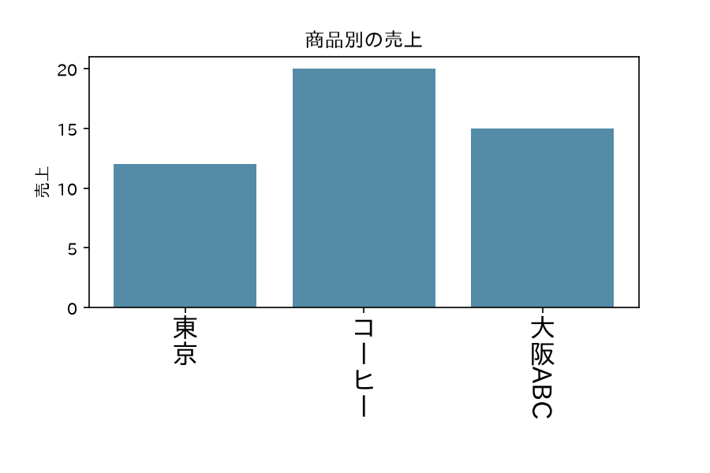

# matplotlib-tategaki

Matplotlib のグラフに日本語の縦書きラベルを表示するライブラリです。

## インストール

```sh
python -m pip install matplotlib-tategaki
```

## Getting Started

`tategaki.enable()` を呼び、`ax.set_xticks()` でラベルと `writing_mode="vertical-rl"` を指定すると、目盛りラベルを縦書きにできます。

Matplotlib に日本語フォントが設定されている環境で、次のコードを実行します。`font.family` は利用できる日本語フォント名に変更してください。

```python
import matplotlib.pyplot as plt
import tategaki

plt.rcParams["font.family"] = "IPAexGothic"
tategaki.enable()

fig, ax = plt.subplots(figsize=(6, 4))
ax.bar([0, 1, 2], [12, 20, 15], color="#548ca8")
ax.set_xticks(
    [0, 1, 2],
    ["東京", "コーヒー", "大阪ABC"],
    writing_mode="vertical-rl",
    orientation="mixed",
    fontsize=16,
)
ax.set_title("商品別の売上")
ax.set_ylabel("売上")
fig.subplots_adjust(bottom=0.35)
plt.show()
```

出力例：



## 改行

`writing_mode="vertical-rl"` の文字列に `\n` を入れると、そこで列が切り替わります。次の列は左側に置かれ、各列は上端から始まります。空の列も幅を持つため、`"東京\n\n大阪"` では二つの文字列の間に一列分の空きができます。

`stack_label()` と `set_xticklabels(..., engine="stacked")` では、一字ずつ並べた上で入力の `\n` を空行として表します。CR やタブなどの制御文字は使用できません。

## 動作環境

- Python 3.11 以上
- Matplotlib 3.10.0 以上
- 日本語フォントが設定された環境

## FAQ

**日本語が表示されない場合は？** まず Matplotlib の日本語フォント設定を確認してください。日本語フォントが設定されていない環境では、`matplotlib-fontja` の使用を推奨します。

**縦書きにならない場合は？** `tategaki.enable()` を呼び、`ax.set_xticks()` に `writing_mode="vertical-rl"` とラベルを指定してください。

**Seaborn のグラフでも縦書きを使えますか？** はい。Seaborn で描画した後、Matplotlib の `Axes` に `ax.set_xticks(..., writing_mode="vertical-rl")` を指定できます。`sns.catplot()` などの複数面で使う場合は、`g.axes.flat` から各軸を取得してください。共有 x 軸は対応していないため、`sharex=False` でご使用ください。

**X 軸の目盛り以外では縦書きを使えませんか？** 使えます。`tategaki.enable()` の後、`ax.text()`、`ax.set_xlabel()`、`ax.set_ylabel()` にも `writing_mode="vertical-rl"` を指定できます。X 軸の目盛りラベルは `ax.set_xticklabels()` でも縦書きにできます。

**括弧や句読点（`（）「」、。`）も縦書きに対応していますか？** はい。縦書き用の字形を持つ日本語フォントを使用すると、縦書きに適した形で表示されます。フォントに縦書き用の字形がない場合は警告が出ます。

**`orientation="mixed"` は何のために指定するのですか？** 日本語と英数字が混在するラベルで、英数字を横組みのまま時計回りに 90 度回転して表示するためです。省略時の `"upright"` では文字を一字ずつ縦に並べます。

## License

ソースコードは MIT ライセンスで公開しています。詳細は [LICENSE](LICENSE) を参照してください。
同梱の Unicode データには [Unicode License v3](src/tategaki/UNICODE-LICENSE.txt) が適用されます。

## Author

Copyright (c) 2026 [magichan](https://github.com/magichan-lab)
